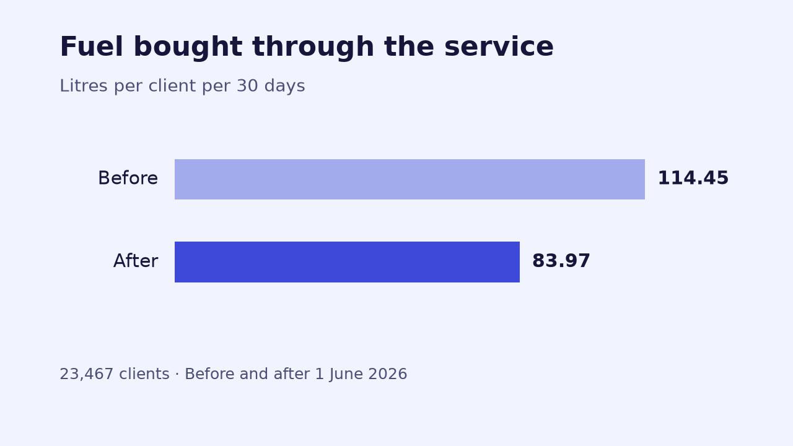
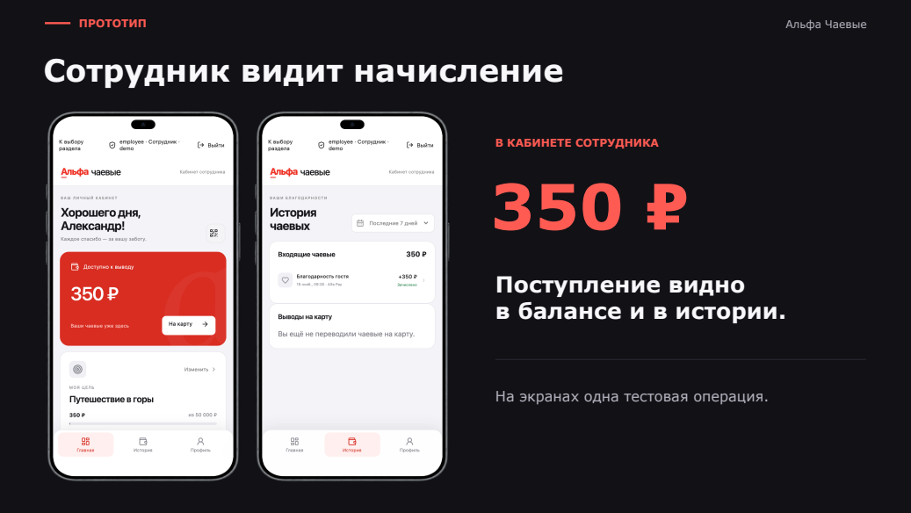
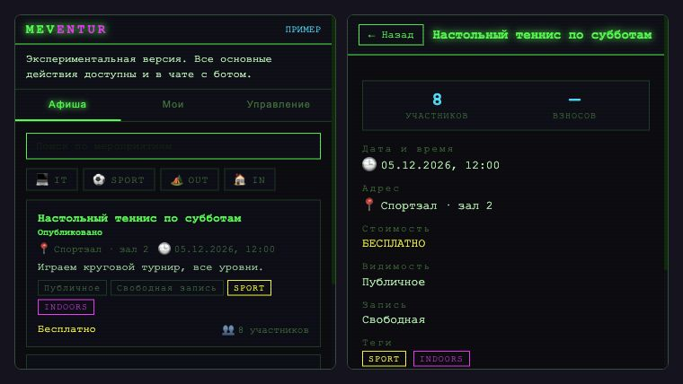
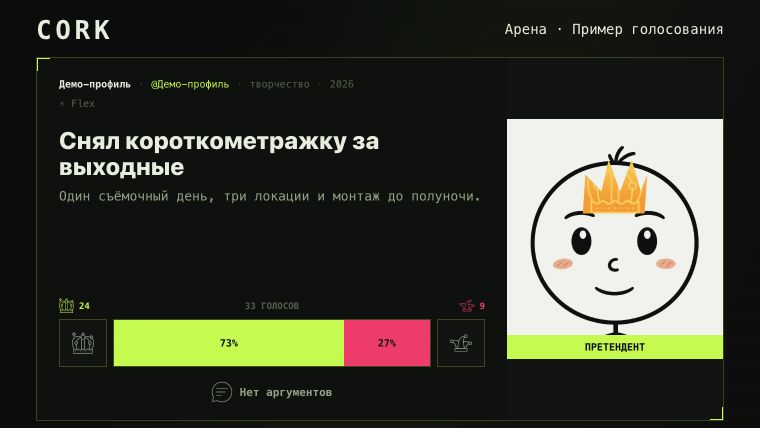

# Vladimir Kaltashev

I build things I can put in front of someone: a tipping flow for a café, a Telegram app for getting people together, or a chart that makes a change in behaviour visible. Economics is where I learned to ask what changes when the incentives do.

**Economics Olympiad** · National finalist and prize winner, roughly top 30 in Russia in my grade 
**English** · IELTS Academic 7.5 · Cambridge B2 First 178/190

## Selected work

<table>
<tr>
<td width="50%" valign="top">

<strong>DANO · When fuel got more expensive</strong> 
Recorded fuel purchases fell 26.6% in the cohort. Fines per client moved by only 0.013 per month. This was a before-and-after comparison.

<a href="https://github.com/VladimirKaltashev/SPB_DANO/blob/main/ANALYSIS_REPORT.md">Read the analysis</a> · <a href="https://github.com/VladimirKaltashev/SPB_DANO">Code</a>
</td>
<td width="50%" valign="top">

<strong>Alfa Tips · From a tip to a staff payout</strong> 
A café tipping prototype with separate experiences for guests, staff, and managers. The screens show a test transaction.

<a href="https://github.com/VladimirKaltashev/Alfa-tip-project">Project and code</a>
</td>
</tr>
<tr>
<td width="50%" valign="top">

<strong>Meventur · Organizing events in Telegram</strong> 
A team hackathon project for finding events, signing up, and getting reminders. The preview shows the event feed and a sample listing.

<a href="https://github.com/kaedeze/TBankHackItOn">Team project and code</a>
</td>
<td width="50%" valign="top">

<strong>CORK · Crown or Clown</strong> 
A social app where people react to posts with a Crown or a Clown vote. The preview shows how the two sides add up on a sample post.

<a href="https://github.com/VladimirKaltashev/CORK">Project and code</a>
</td>
</tr>
</table>

## More projects

- **[Build Your Dream Castle](https://github.com/VladimirKaltashev/VladimirKaltashev/blob/main/PROJECTS.md#build-your-dream-castle)** · An early browser prototype for placing towers and drawing walls in 3D.
- **[Doonext](https://github.com/VladimirKaltashev/VladimirKaltashev/blob/main/PROJECTS.md#doonext)** · My Telegram planner for tasks, deadlines, and completed work.
- **[SAT Practice Trainer](https://github.com/VladimirKaltashev/VladimirKaltashev/blob/main/PROJECTS.md#sat-practice-trainer)** · A local trainer for timed Reading and Writing practice and answer review.

I studied Kotlin backend development at [T-Bank Faculty Day](https://github.com/VladimirKaltashev/faculty_day_fork_Vlad). Outside projects, I play table tennis and speedcube.
